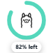
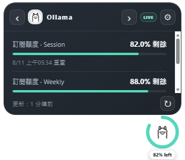
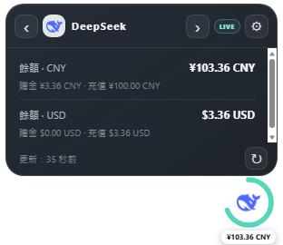
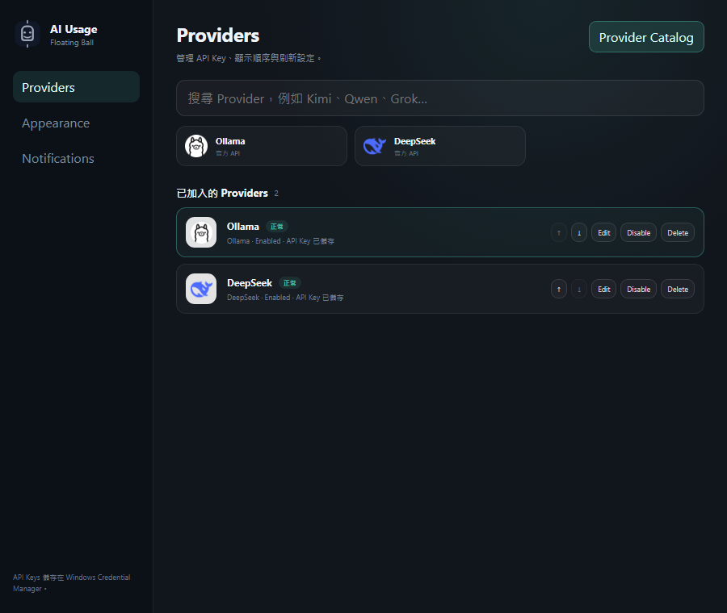

# AI Usage Floating Ball

[English](README.en.md) | [繁體中文](README.md)


AI Usage Floating Ball keeps provider balance, subscription quota, reset time and connection health in one small desktop widget. API keys are stored in **Windows Credential Manager** and are never written to configuration files, snapshots, logs or this repository.

### Screenshots

<p align="center">
  
</p>

<p align="center">
  
  
</p>



All screenshots use fixed `?demo=1` data and contain no real API keys or account balances.

### Features

- Transparent 76×76 always-on-top floating ball.
- Hover to expand the information card and switch providers with the left/right arrows.
- Capacity ring, percentage/currency label and official provider icons.
- Optional docking at the left, right or top screen edge with hover reveal.
- Separate Ollama subscription quota and purchased-credit modes.
- DeepSeek Auto/CNY/USD primary balance selection.
- Per-provider refresh scheduling and independent failure handling.
- Automatic refresh when opening a card with data older than 30 seconds.
- Manual refresh always performs a new request.
- Last-known-good data, stale/error states and actionable error messages.
- Windows Tray, optional start with Windows, native notifications and thresholds.
- Provider Catalog, API key testing, reorder, enable/disable and delete.

### Supported providers

| Provider | Integration | Primary data |
| --- | --- | --- |
| Ollama | Official API | Subscription windows and purchased balance |
| DeepSeek | Official API | CNY/USD balance |
| OpenRouter | Official API | Key limit, credits and usage |
| Kimi Global/China | Official API | Available, voucher and cash balance |
| Grok / xAI | Management API | Prepaid balance; Team ID required |
| Qwen / DashScope | Custom endpoint | Endpoint-defined quota, balance or usage |
| Groq | Custom endpoint | Endpoint-defined quota, balance or usage |
| Mistral | Custom endpoint | Endpoint-defined quota, balance or usage |
| Together AI | Custom endpoint | Endpoint-defined quota, balance or usage |
| Custom API | JSON path mapping | User-defined balance, limit, usage and reset time |

A normal inference API key does not necessarily have permission to query billing data. Use a provider billing/usage endpoint with Custom API when no native balance endpoint is available.

### Install

1. Open [Releases](https://github.com/gcgcg123/Ai-Usage-Floating-Ball/releases/latest).
2. Download `AI Usage Floating Ball_0.5.0_x64-setup.exe`.
3. Install and launch it from the Start menu.

Windows 10/11 and Microsoft Edge WebView2 Runtime are required. WebView2 is normally included with Windows 11.

### What does “unsigned installer” mean?

The installer is currently **unsigned**. It does not contain an Authenticode digital signature from a trusted code-signing certificate.

This means Windows cannot cryptographically verify:

- who built and published the file;
- whether the file was modified after packaging;
- whether the publisher has an established SmartScreen reputation.

As a result, Windows SmartScreen may show a warning such as “Windows protected your PC” or “Unknown publisher”. This warning means Windows cannot verify the publisher; it does **not** automatically mean the file is malicious.

The Release includes a SHA-256 hash. You can verify the downloaded file before running it:

```powershell
Get-FileHash -Algorithm SHA256 `
  -LiteralPath ".\AI.Usage.Floating.Ball_0.5.0_x64-setup.exe"
```

Compare the result with the SHA-256 shown in the Release notes.

### Signed vs. unsigned

| | Unsigned | Signed with Authenticode |
| --- | --- | --- |
| Publisher identity | Windows cannot verify it | Certificate identifies the publisher |
| File integrity | Hash must be checked manually | Signature validation can detect tampering |
| SmartScreen | More likely to show an unknown-publisher warning | Usually improves reputation and reduces warnings |
| Certificate cost | None | Requires a trusted code-signing certificate and identity verification |
| Trust guarantee | The signature says nothing | A signature proves publisher/integrity, but does not prove the app has no bugs |

Possible signing options include an OV/EV code-signing certificate, Azure Trusted Signing, or a signing service such as SignPath. This personal project is currently distributed unsigned to avoid certificate and identity-verification costs.

### First use

1. Hover over the floating ball and open Settings.
2. Select a provider in Provider Catalog.
3. Enter a display name and API key.
4. Click **Test Connection**.
5. Click **Save** after the test succeeds.

The API key is written directly to Windows Credential Manager. Leave the key field empty while editing to keep the existing key.

#### Ollama modes

- **Auto (subscription first):** use Session/Weekly/Monthly quota when available; otherwise use the purchased balance.
- **Subscription only:** use the subscription window with the lowest remaining percentage.
- **Balance only:** use Ollama purchased credit balance.

Subscription percentage thresholds and monetary balance thresholds are separate settings.

#### DeepSeek currency

DeepSeek may return both CNY and USD. Choose Auto, CNY or USD as the primary currency used by the floating ball. The information card still lists every currency separately.

### Refresh behavior

- Background refresh follows each provider's 5/10/15-minute setting.
- Opening a card refreshes data older than 30 seconds, with a 15-second throttle.
- Manual ↻ always makes a new request.
- Failed requests preserve the last successful data and display a stale/error state.

Providers do not push balance webhooks, so a top-up cannot appear in the same second unless the app refreshes or the card is opened.

### Privacy and security

- API keys are stored only in Windows Credential Manager.
- No telemetry or analytics.
- HTTPS is required for native and remote Custom API endpoints.
- Local `settings.json` and `snapshots.json` do not contain API keys.
- Provider requests disable HTTP caching.
- Secret scanning, `.gitignore`, Dependabot and Windows CI are included.

See [SECURITY.md](SECURITY.md) for details.

### Development

Requirements: Windows 10/11, Node.js 22+, Rust stable, Microsoft C++ Build Tools, Windows SDK and WebView2 Runtime.

```powershell
npm install
npm run tauri dev
```

Verification:

```powershell
npm test
npm run build
npm run check:secrets
cargo test --manifest-path src-tauri/Cargo.toml
cargo clippy --manifest-path src-tauri/Cargo.toml --all-targets -- -D warnings
```

Release installer:

```powershell
npm run tauri -- build
```

Demo UI:

```text
http://localhost:1420/?demo=1
http://localhost:1420/?demo=1&expanded=1
http://localhost:1420/?window=settings&demo=1
```
