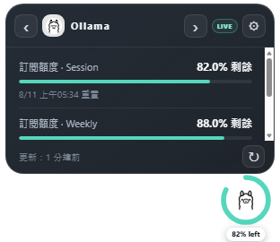
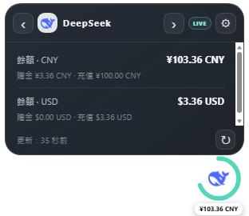
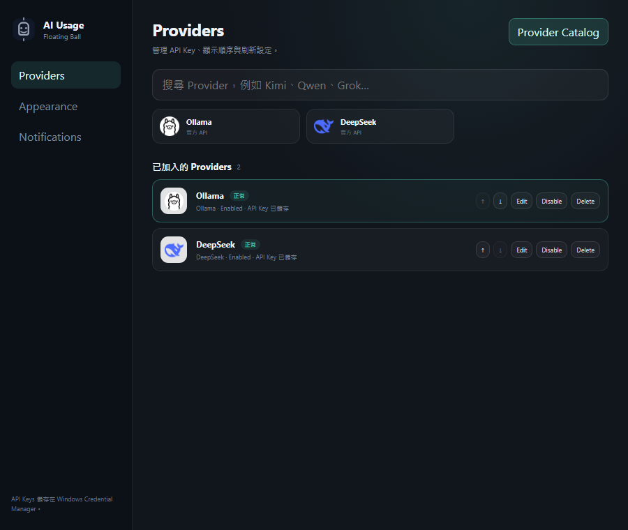

# AI Usage Floating Ball

[English](README.en.md) | [繁體中文](README.md)

AI Usage Floating Ball 是一個 Windows 桌面 AI API 用量監測懸浮球，集中顯示供應商餘額、訂閱額度、重置時間和連線狀態。API Key 儲存在 **Windows Credential Manager**，不會寫入設定檔、Snapshot、日誌或 Repository。

### 截圖

<p align="center">
  
</p>

<p align="center">
  
  
</p>



所有截圖均使用固定 `?demo=1` 示範資料，不包含真實 API Key 或帳戶餘額。

### 功能

- 透明、Always-on-top 的 76×76 懸浮球。
- 滑鼠移入展開資訊卡，左右箭嘴切換供應商。
- 容量環、百分比／金額標籤及官方供應商圖示。
- 可停靠螢幕左側、右側或上方，摺疊時只留提示邊。
- Ollama 可分別追蹤訂閱額度與加購餘額。
- DeepSeek 可選 Auto／CNY／USD 作為主要幣種。
- 每個 Provider 獨立刷新排程和錯誤退避。
- 開啟資訊卡時，超過 30 秒的資料會自動刷新。
- 手動 ↻ 一定重新查詢。
- 保留最後成功資料，並顯示 Stale／Error 和處理建議。
- Windows Tray、開機啟動、系統通知和警示門檻。
- Provider Catalog、Test Connection、排序、啟用／停用及刪除。

### 支援的供應商

| 供應商 | 接入方式 | 主要資料 |
| --- | --- | --- |
| Ollama | 官方 API | 訂閱額度、加購餘額 |
| DeepSeek | 官方 API | CNY／USD 餘額 |
| OpenRouter | 官方 API | Key limit、credits、usage |
| Kimi 國際／中國 | 官方 API | 可用餘額、voucher、cash |
| Grok / xAI | Management API | Prepaid balance；需要 Team ID |
| Qwen / DashScope | Custom endpoint | 端點自訂的 quota／balance／usage |
| Groq | Custom endpoint | 端點自訂的 quota／balance／usage |
| Mistral | Custom endpoint | 端點自訂的 quota／balance／usage |
| Together AI | Custom endpoint | 端點自訂的 quota／balance／usage |
| Custom API | JSON path mapping | 自訂餘額、上限、用量與重置時間 |

一般 Inference API Key 未必有 Billing 查詢權限。如果官方沒有公開餘額 endpoint，請使用對應的 Billing／Usage endpoint 配合 Custom API。

### 安裝

1. 前往 [Releases](https://github.com/gcgcg123/Ai-Usage-Floating-Ball/releases/latest)。
2. 下載 `AI Usage Floating Ball_0.5.0_x64-setup.exe`。
3. 安裝後從開始功能表啟動。

需要 Windows 10／11 和 Microsoft Edge WebView2 Runtime；Windows 11 通常已內建。

### 「Installer 沒有簽名」是甚麼意思？

目前的安裝檔是 **Unsigned**，即沒有使用受信任的 Code-signing Certificate 加入 Authenticode 數碼簽名。

因此 Windows 無法用密碼學方式直接確認：

- 檔案由哪個已驗證的發佈者建立；
- 打包後是否曾被修改；
- 發佈者是否已累積 SmartScreen 信譽。

所以 SmartScreen 可能顯示「Windows 已保護您的電腦」或「未知發佈者」。這是 Windows 無法驗證發佈者，不代表檔案一定是惡意程式。

每次 Release 都會提供 SHA-256。你可以在執行前自行核對：

```powershell
Get-FileHash -Algorithm SHA256 `
  -LiteralPath ".\AI.Usage.Floating.Ball_0.5.0_x64-setup.exe"
```

將結果與 Release 頁面的 SHA-256 比較。

### 簽名與不簽名的分別

| | 不簽名 | Authenticode 簽名 |
| --- | --- | --- |
| 發佈者身份 | Windows 無法驗證 | Certificate 可顯示已驗證的發佈者 |
| 檔案完整性 | 需要手動核對 Hash | 簽名驗證可發現檔案被竄改 |
| SmartScreen | 更容易顯示未知發佈者警告 | 通常可建立信譽並減少警告 |
| 成本 | 無 | 需要受信任的 Code-signing Certificate 和身份驗證 |
| 信任保證 | 無法從簽名判斷 | 證明發佈者和完整性，但不代表程式沒有 Bug |

常見方案包括 OV／EV Code-signing Certificate、Azure Trusted Signing 或 SignPath 等簽名服務。本個人專案目前為節省 Certificate 和身份驗證成本，以 Unsigned 形式發佈。

### 第一次使用

1. 將滑鼠移到懸浮球，按齒輪開啟 Settings。
2. 在 Provider Catalog 選擇供應商。
3. 輸入 Display name 和 API Key。
4. 按 **Test Connection**。
5. 測試成功後按 **Save**。

API Key 會直接寫入 Windows Credential Manager。再次編輯時留空即可保留原有 Key。

#### Ollama 追蹤模式

- **自動（訂閱優先）**：有 Session／Weekly／Monthly 時使用訂閱額度，否則使用加購餘額。
- **只追蹤訂閱額度**：以剩餘百分比最低的訂閱窗口為準。
- **只追蹤加購餘額**：使用 Ollama purchased credit balance。

訂閱百分比門檻與金額餘額門檻分開設定，不會互相換算。

#### DeepSeek 幣種

DeepSeek 可能同時回傳 CNY 和 USD。可選 Auto、CNY 或 USD 作為懸浮球主要幣種；資訊卡仍會分開列出所有幣種。

### 刷新策略

- 背景按每個 Provider 的 5／10／15 分鐘設定刷新。
- 開啟資訊卡時，資料超過 30 秒會自動刷新，15 秒內不重複查詢。
- 手動 ↻ 一定重新查詢。
- 請求失敗會保留最後成功資料，顯示 Stale／Error。

供應商不會主動推送 balance webhook，因此充值後需要 App 自動刷新或你按下 ↻ 才會反映。

### 私隱與安全

- API Key 只存於 Windows Credential Manager。
- 無遙測、無分析追蹤。
- 原生及遠端 Custom API 必須使用 HTTPS。
- 本機 `settings.json` 和 `snapshots.json` 不含 API Key。
- API 請求停用 HTTP cache。
- Repository 包含 secret scan、`.gitignore`、Dependabot 和 Windows CI。

詳細內容請看 [SECURITY.md](SECURITY.md)。

### 開發

需求：Windows 10／11、Node.js 22+、Rust stable、Microsoft C++ Build Tools、Windows SDK、WebView2 Runtime。

```powershell
npm install
npm run tauri dev
```

驗證：

```powershell
npm test
npm run build
npm run check:secrets
cargo test --manifest-path src-tauri/Cargo.toml
cargo clippy --manifest-path src-tauri/Cargo.toml --all-targets -- -D warnings
```

建立 Release installer：

```powershell
npm run tauri -- build
```

示範 UI：

```text
http://localhost:1420/?demo=1
http://localhost:1420/?demo=1&expanded=1
http://localhost:1420/?window=settings&demo=1
```
